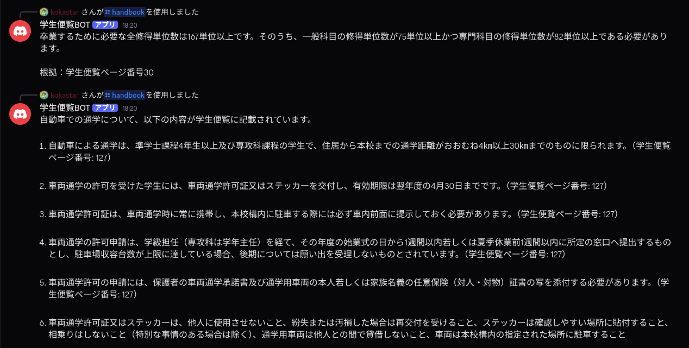

# 学生便覧 RAG Discord Bot



ローカルのvLLMと既存の`RAG/GenResponce.py`を使い、Discordの
`/handbook`コマンドから[学生便覧](https://www.kisarazu.ac.jp/wp-content/uploads/2026/03/bebe6bb8cb93e97b2f34d80943b5f163.pdf)を検索するBotです。

Discord Botは`gen_response()`を直接呼び出します。`run.py`を使うと、
vLLM（既定: `127.0.0.1:8000`）の準備完了後にDiscord Botを起動し、
両方をまとめて停止できます。

## 開発背景
RAGの勉強をしたかったので，簡易RAGを作ってみました．
それを実際のプロダクトに組み込んでみようと思ったので，
RAGディレクトリの中のコードは自分が全部実装し，
それに合わせてCodexにDiscordBOT化してもらいました．

## セットアップ(Discord)

Python 3.12、vLLMが利用できるGPU環境、およびDiscord Botトークンが必要です。

```bash
python3 -m venv env
source env/bin/activate
pip install -r requirements.txt
cp discordbot/.env.example discordbot/.env
```

`discordbot/.env`を編集します。

```dotenv
DISCORD_BOT_TOKEN=取得したBotトークン
DISCORD_GUILD_ID=開発用DiscordサーバーのID
```

`DISCORD_GUILD_ID`は任意です。指定すると、そのサーバーだけにスラッシュ
コマンドを同期するため開発中の反映が速くなります。未指定時はグローバル同期です。

Discord Developer PortalのOAuth2 URL Generatorでは`bot`と
`applications.commands`を選択してBotをサーバーへ追加してください。
特権Intentは不要です。

## セットアップ(RAG)
RAGを事前に構築する必要があります．とは言っても自作の簡易RAGなので大したことはしません．
`student-handbook.pdf`に学生便覧をおいた上で，

```bash
source env/bin/activate
python RAG/PDFsplitChunk.py
python RAG/ChunkToEmbedding.py
```
を実行します．

`PDFsplitChunk.py`では，`student-handbook.pdf`を読み取りチャンク単位に分割します．
この際，木更津高専の学生便覧のフォーマットに合わせてページ番号も取得するようにしています．
分割したデータは，`RAG/data/student_handbook_chunks.json`に保存されます．
これがLLMに渡すコンテキスト，及び次のステップでEmbeddingに変換するためのデータになります．

`ChunkToEmbedding.py`では，先程分割したチャンクのうち，ページ番号が振られているページに配置されているチャンクのみをEmbeddingにします．
Embeddingにしたら，`RAG/data/student_handbook_embeddings.npy`として保存します．

RAGはこの後，ユーザーからのクエリをEmbeddingにし，それと一致度が高いEmbeddingを探索します，
一致度のtop-k(デフォルトでk=5)について，jsonをもとに元の文章及びそのページ数を取得し，クエリとともにLLMに提供することでRAGとしての機能を果たします．

## 統合起動

リポジトリのルートで実行します。

```bash
source env/bin/activate
python run.py
```

vLLMの`GET /v1/models`が応答可能になるまで待ってからBotが起動します。
停止は`Ctrl+C`です。どちらかが異常終了した場合も、残ったプロセスを終了します。

Discordでは次のように質問できます。

```text
/handbook question:卒業に必要な単位数は？
```

## 起動設定

| 変数 | 既定値 | 用途 |
|---|---|---|
| `VLLM_MODEL` | `Qwen/Qwen3-8B` | vLLMが読み込むモデルのパスまたはID |
| `VLLM_STARTUP_TIMEOUT` | `600` | vLLM起動待ち秒数 |

`GenResponce.py`の既存設定に合わせ、vLLMは`127.0.0.1:8000`で起動します。
`VLLM_MODEL`をローカルパスへ変更しても、vLLMには既存コードが要求する
`Qwen/Qwen3-8B`名で公開されます。

## 個別起動

デバッグ時は別々にも起動できます。

```bash
vllm serve Qwen/Qwen3-8B --host 127.0.0.1 --port 8000
python discordbot/bot.py
```

## テスト

```bash
pytest
```
